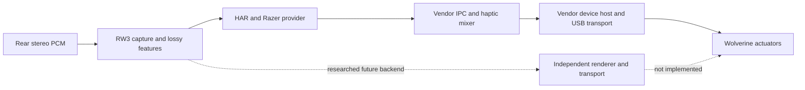

# Remaining conversation plan and Synapse independence — 2026-11-08

## Result

**Full Synapse independence is not implemented or demonstrated.** The current Sensa path still uses the installed vendor runtime. Closing a window, keeping vendor services, and replacing the entire vendor output stack are different outcomes. Removing Synapse is not evidence that the remaining output reproduces DualSense haptic PCM.

The microphone audit is complete as an acquisition exercise, but [physical repeatability/fidelity acceptance remains open](ACOUSTIC_RESULTS_20261108.md). Its large repeat variation must not be attributed to Synapse alone without isolating the cause. Replacing a component does not automatically fix it.

## Plan supplied in this conversation

Source: the user's original pasted conversation attachment, `Yapıştırılan metin.txt` (6,088 bytes), reviewed together with this chat's messages. No Claude account/session was accessed. The attachment proposes mode detection first, then virtual-controller-dependent routes.

| Item from the supplied conversation | Current local state | Remaining acceptance |
| --- | --- | --- |
| Simplified UI, auto-run, remove finder/expert windows, 23 demos and DualSense reference | Implemented locally | Current packaging/CI and actual reference response; source bytes unchanged, Exclusive-only |
| Detect PC/Xbox mode, PC audio→Sensa | Prototype implemented | One-mic audit found repeat variation; general audio clipping, source loss/reconnect, long sessions and physical stop still need acceptance |
| Xbox audio→body/trigger motors | WGI prototype implemented | Current measurements used wired PC mode, so they do not validate this backend. Historical Xbox observations are separate |
| Game XInput rumble→Sensa | Not implemented | Virtual-controller input forwarding plus a verified virtual output callback; distinguish actual game commands from generated tests |
| Native DualSense plus trigger-command conversion in Xbox mode | Not implemented | Full virtual DualSense source/input association and verified output reports; W3 trigger rumble cannot reproduce adaptive-trigger resistance |
| Authentic game-authored rear PCM→Wolverine | Synthetic endpoint route previously tested; authentic-game acceptance open | One real title, exact game/build, input/audio association, rear provenance, no double input, repeatable physical response |
| Fully standalone Sensa | Research only | See the independent output stages below; no driver replacement or vendor-service shutdown performed |

The local HIDMaestro code checks/setup/self-tests a virtual controller. It is not a demonstrated continuous Wolverine→virtual-DualSense input bridge. More UI modes or a virtual endpoint alone do not fill that gap. Body haptics for Windows story games remain the priority; Xbox/trigger work is secondary.

## Verified dependency evidence

- Razer's current [DevKit setup](https://github.com/WyvrnOfficial/RazerSensa_DevKit/blob/master/README.md) requires Synapse 4 with Chroma and describes approximately 33ms output quantization. This supports retaining current 33ms output pacing; faster software frame generation is not faster measured motor output.
- Official [WYVRN haptics documentation](https://doc.wyvrn.com/docs/wyvrn-sdk/wyvrn-configuration/haptics/) describes named events mapped to `.haps` files by the installed Haptic Service. It is not a documented arbitrary live PCM replacement for that service.
- PadForge's own [Sensa service implementation](https://github.com/hifihedgehog/PadForge/blob/main/PadForge.App/Services/SensaHapticsService.cs) and [internals documentation](https://padforge.org/docs/reference/sensa-haptics-internals/) also depend on the installed Razer runtime. Its direct lighting backend is not a standalone Sensa haptics backend.
- Local read-only inventory observed HapticService running automatically (file/product version **1.2.2.0**), RazerExperienceService, Chroma SDK Server and multiple RazerAppEngine processes. An installed RzInterHaptics DLL reported **1.0.0.5**. Presence is not proof every listed process is required. The actual microphone tests used this installed stack; they were not Synapse-off tests. Local inventory: `TestResults/acoustic-audit-20261108/runtime-dependencies.json`.

## What a lower-level replacement would need

Current path, combining local findings and explicitly labelled third-party static analysis:

The author of [razer_ui's Sensa analysis](https://github.com/han1548772930/razer_ui/blob/main/docs/products/host/sensa.md) traces provider IPC, device registration, native callbacks and the final device stream submission. This is **third-party static reverse-engineering evidence**, not a vendor-supported contract or a test of our installed versions. Its own current Rust Sensa capability section says the independent production chain is missing.

An important boundary: a provider branch called direct-device still reaches a proxy/FFI/host/device callback chain in those notes. It does not establish that copying two DLLs gives us direct USB control without the vendor host. Successful IPC sends or callback returns also do not acknowledge physical delivery. Do not implement hard-coded addresses/vtables or guessed frame packing from these notes.

The Wolverine's headset UAC interface is not a demonstrated body-actuator PCM endpoint. Its current output route is parametric, with one dominant frequency, envelope points and limited transients. An independent implementation must still solve richer encoding and device response; independence alone cannot restore phase/multiband information already discarded by extraction.

## Practical options

| Option | Removes | Retains / limitation |
| --- | --- | --- |
| RW3 UI only in normal use, vendor UI hidden/closed | User interaction with Synapse | Vendor services/device host; not full independence. Exact minimum-process behavior is untested |
| Vendor-supported minimal runtime deployment | Potentially the large UI/application bundle | Needs an actual documented redistribution/setup contract and a tested supported runtime. Not established by copying installed binaries |
| RW3-owned headless host using licensed vendor components | Potentially some vendor UI/mixer ownership | Hypothesis; registration, callbacks, USB ownership and licensing remain. Still vendor-binary dependence |
| Independent Sensa renderer and device transport | Vendor process/runtime dependence if successful | Substantial unproven work: device identity, modes, discovery, protocol/encoder, scheduling, stop/underrun, reconnect and coexistence. No implementation or W3 hardware proof yet |
| Conventional XInput/WGI rumble | Sensa runtime path | Lower capability output. [XInput's documented interface](https://learn.microsoft.com/en-us/windows/win32/api/xinput/ns-xinput-xinput_vibration) exposes motor levels, not stereo PCM. Must remain explicitly selected Normal/rumble behavior, with no silent Native fallback |

## Ordered next steps

1. **Stabilize evidence first.** Repeat a small fixed scene with one long-lived engine, then compare to per-case initialization. Observe source features/provider calls and mic controls separately. Investigate high repeat variation and the elevated tail before changing gains or claiming a fix.
2. **Separate output ownership in the design.** Keep source preservation/analysis independent of a backend that explicitly reports capabilities, runtime dependencies, accepted format/rate, loss counters and stop state. Keep the present vendor path usable and labelled lossy; an independent backend must not silently fall back to it or to XInput.
3. **Establish the supported minimum runtime.** Obtain vendor documentation/license terms for a headless/minimal distribution. A controlled later experiment can distinguish UI closure, vendor mixer/device-host presence, and vendor services stopped. Preserve exact process/service states and a restoration plan; do not stop all Razer processes blindly.
4. **If complete replacement is still required, establish a legal, versioned device contract.** Prefer documented vendor transport/encoder APIs. Otherwise passive analysis of the user's own device and an isolated transport experiment require explicit setup/rollback before any capture-driver installation, driver rebinding or HID takeover. No firmware patching or arbitrary game interception.
5. **Build only after the contract is sufficient.** Dedicated output ownership, bounded queue/rate, independent stop/watchdog, device-specific channel mapping, endpoint-loss cleanup and input coexistence. Do not hand-pack the unknown bands 2–3 encoder.
6. **Prove full independence.** Record zero required Razer processes/services/vendor binaries, unchanged original source hash, separate L/R actuator response, silence/stop/disconnect/reconnect, sustained use and real-game provenance. Compare physical DualSense later using unmodified Exclusive reference. A software counter or an app running with Synapse merely minimized is insufficient.

No Synapse service, driver or firmware was changed for this research. This document is an implementation/validation plan, not a claim that a standalone Sensa backend already works. M3 and M4 remain open.
